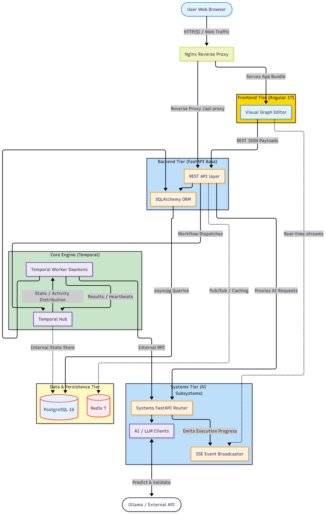

# UPIAA System Architecture Design

## Executive Summary

The UPIAA project is an enterprise-grade, agentic workflow automation platform engineered to enable users to visually construct, manage, and execute complex logic chains. Built on a resilient three-tier architecture, UPIAA integrates robust AI-driven logic nodes with high-availability infrastructure. The system is designed to provide real-time execution feedback while guaranteeing state durability across all workflow operations, ensuring fault tolerance and high reliability even in the event of partial system failures.

At its core, the platform leverages Temporal as an orchestration engine, allowing the system to abstract away the complexities of transient failures, retries, and distributed state management. This is coupled with a highly responsive Angular 17 frontend and a highly concurrent FastAPI asynchronous backend, yielding an environment that is optimized for both rapid development and strict production workloads.

---

## System Architecture Overview

The UPIAA ecosystem utilizes a tightly decoupled architecture, communicating over strict HTTP interfaces and managed event streams. The platform boundaries are strategically defined to separate state management, asynchronous workflow execution, and user interaction.

The flow of requests generally proceeds as follows:
1. The user interacts with the Angular visual orchestrator, dragging nodes and connecting endpoints.
2. The user initiates a run, prompting the UI to dispatch a REST API call to the FastAPI backend via the Nginx Reverse Proxy.
3. The backend validates the directed acyclic graph (DAG) and requests a workflow execution from the Temporal Server.
4. Temporal Server manages the workflow state and enqueues Activity Tasks, which are consumed and processed by the decoupled Python Temporal Workers.
5. As the workers process tasks (including API calls, logic evaluation, and AI Agent interactions), they dispatch execution context updates which are streamed back to the client in real-time via Server-Sent Events (SSE).


Demostration diagram image:

---

## Frontend Architecture (Angular 17)

The frontend operates as a reactive Single Page Application (SPA), utilizing **Angular 17** paired with **Tailwind CSS** to deliver a premium, responsive user interface.

**Component Organization:**
The application strictly follows a component-driven architecture. Complex interactions are decoupled into dumb presentation components and smart container components. 
- **Graph Visualization:** The core visual workflows rely on libraries like `ngx-graph` and `D3.js` to render highly interactive Directed Acyclic Graphs (DAGs), ensuring the user can organically observe the execution topology.
- **State Management:** Reactive streams via RxJS are utilized natively to manage complex client-side state without external store bloat.

**Real-Time Data Flow (SSE):**
To avoid polling overhead, the application utilizes Server-Sent Events (EventSource API). The Angular services subscribe to dedicated backend endpoints, streaming structured execution updates, state shifts, and logging outputs natively in real-time, instantly reflecting node-level changes in the visual orchestrator.

---

## Backend Engine (FastAPI & Temporal)

The UPIAA backend serves as the traffic director and execution layer, broken down into horizontal API routing and distributed workflow execution.

**FastAPI Controller Layout:**
The application utilizes **FastAPI** to yield incredibly high throughput via `asyncio`. Controllers are separated via distinct router modules in the `routes/` directory. They consume Pydantic schemas validating all outbound and inbound HTTP interactions, ensuring stringent typing guarantees.

**Database Layer:**
Interactions with the PostgreSQL infrastructure are highly concurrent, utilizing **SQLAlchemy 2.0 (Async)** bundled with **asyncpg**. Database schema migration enforcement is managed through **Alembic**, safeguarding against destructive data deviations across environments.

### The Temporal Workflow Engine

At the heart of the system is the **Temporal Orchestration Engine**, a critical component protecting LLM execution layers and multi-stage API integrations.
- **Workflow Definitions:** Complex logic (such as parallel node execution or recursive agent steps) is modeled as Temporal Workflows. These sequences denote strict, absolute progression states. If the system crashes mid-workflow, it automatically replays events on a new cluster without duplicating actions.
- **Activity Execution:** Any operation that involves side-effects (database writes, Ollama inferences, third-party network requests) is cordoned off into localized *Activities*. These are executed by independently scaled `worker.py` instances.
- **LLM Contracts:** AI tasks rely on strict payload contracts. Raw textual replies from external local endpoints (like Ollama) are validated heavily via localized Pydantic models. Temporal handles automated back-offs and retries if an LLM returns hallucinated formats, creating an autonomous self-healing execution node.

---

## Infrastructure & Networking (Infra)

The `infra/docker-compose.yml` models a complete, containerized environment ensuring the production deployment exactly mirrors local development operations without variance.

- **Nginx (Reverse Proxy):** Operates as the singular entry gateway, routing `/api/` traffic cleanly to the FastAPI backend while serving static Angular bundle files on port `80`.
- **PostgreSQL 16:** The primary relational data store. It serves an essential dual purpose: housing business-logic data (like User Credentials and Workflow Layout states) and acting as the durable state repository for the internal Temporal hub.
- **Redis 7:** Leveraged as a distributed caching layer and message broker to handle transient ephemeral states or auxiliary caching optimizations without invoking costly disk I/O.
- **Temporal Server:** Operates as its own cluster micro-dependency hub. It monitors activity pipelines and dispatches orchestrations smoothly across all `temporal-worker` daemons.
- **Backend / Workers:** Separates HTTP request resolution (`backend`) from heavy asynchronous lifting (`temporal-worker`). This prevents long-running tasks from bottlenecking user-facing HTTP throughput.
- **Systems (AI Layer):** A wholly distinct container focused solely on compiling nodes, querying LLMs, orchestrating workflow builds, and managing conversational logic. Uses authenticated internal tokens to speak safely with the backend without exposing raw logic to internet-origin queries.

---

## Directory Structure & Module Boundaries

The repository segregates responsibilities intelligently:

```text
UPIAA/
├── backend/                       # Core python asynchronous execution tier
│   ├── ai/                        # (DEPRECATED) Legacy AI connection logic 
│   ├── ai_nodes/                  # Auto-generated workflow nodes produced by System 1
│   ├── core/                      # Application configs, secrets, & vault cryptography
│   ├── nodes/                     # Business logic isolating distinct Node/Activity features
│   ├── routes/                    # FastAPI HTTP endpoint definitions (Controllers)
│   ├── storage/                   # SQLAlchemy ORM models, async database wrappers & migrations
│   ├── test/                      # Pytest integrations protecting endpoints
│   ├── main.py                    # API Entrypoint mounting ASGI app
│   └── worker.py                  # Temporal process daemon (listens for orchestrated Tasks)
│
├── systems/                       # Decoupled AI subsystem layer (Containerized)
│   ├── main.py                    # Isolated ASGI FastAPI for generation
│   ├── shared/                    # Protected execution scopes, internal HTTP tokens
│   ├── system1/                   # Node generation, prompt compilation, and deployment
│   ├── system2/                   # Natural language to DAG workflow generation
│   ├── system3/                   # "Hermies" Memory model and interactions
│   └── system4/                   # Node testing pipelines preventing execution of bad code
│
├── frontend/                      # User interface and client applications
│   ├── src/                       # Angular components, direct UI layouts, & SSE services
│   ├── public/                    # Assets and global styles
│   └── tailwind.config.js         # Design tokenization definitions
│
└── infra/                         # Production-ready docker environments
    ├── nginx/                     # Core routing configurations
    ├── postgres/                  # Init schema scripts for cluster hydration
    └── docker-compose.yml         # Container declarations, healthchecks & networking boundaries
```
